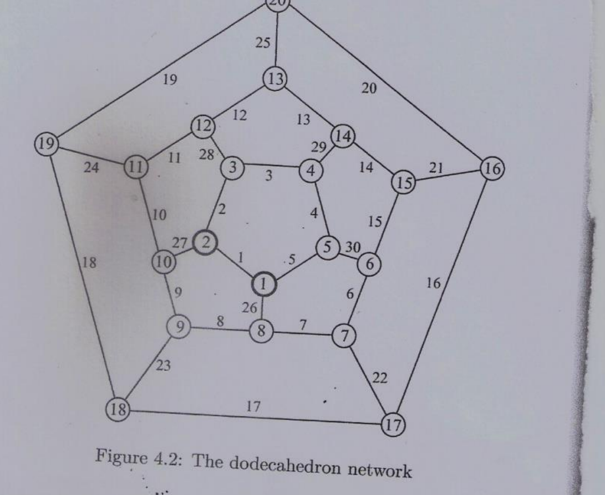

# תקציר

בעבודה נכתבה תוכנה (Python) שמעריכה את האמינות של רשת הדודקהדרון (20 קודקודים אמינים, 30 צלעות לא אמינות) בשיטת Crude Monte Carlo. קריטריון ה-UP הוא Terminal Connectivity, עם שלושה טרמינלים שנקבעו על ידי המרצה: **T1=4, T2=10, T3=17**. מצב הרשת בכל ניסוי נבדק באמצעות DSS (Union-Find).

עיקרי התוצאות:

- האמינות עולה בצורת S חדה עם p: מ-≈0 ב-p=0.1, דרך ≈0.19 ב-p=0.5, ועד ≈1 ב-p=0.99.
- האומדנים עם M=1000 ועם M=10000 עקביים זה עם זה בכל ערכי p: ההפרש ביניהם נמצא תמיד בתוך טווח השגיאה הסטטיסטית הצפוי (לכל היותר 1.87 סטיות תקן).
- סעיף E (p=0.9, M=1000, חמש הרצות): ממוצע 0.9962, סטיית תקן 0.00130, **טעות יחסית ≈ 0.13%**. הערך התיאורטי לפי נוסחת השונות של CMC הוא 0.20%, ומדגם של חמש הרצות בלבד מסביר את הפער.

# שלב 1 – הגדרת הבעיה והרשת (סעיף B)

הרשת היא רשת הדודקהדרון (Figure 4.2): גרף לא מכוון, 3-רגולרי (לכל קודקוד 3 שכנים), עם n=20 קודקודים ו-m=30 צלעות.

{width=60%}

- **קודקודים אמינים, צלעות לא אמינות:** כל צלע i תקינה (up) בהסתברות p~i~, באופן בלתי תלוי בשאר הצלעות. בסעיף C כל הצלעות זהות: p~i~ = p.
- **קריטריון UP – Terminal Connectivity:** הרשת במצב UP אם ורק אם כל הטרמינלים נמצאים באותו רכיב קשירות של תת-הגרף המורכב מהצלעות התקינות.
- **טרמינלים:** T1=4, T2=10, T3=17 (כפי שנקבעו על ידי המרצה).
- **אמינות הרשת:** R = P(network is UP).

טבלת הצלעות כפי שנקראו מהשרטוט (מספור הצלע ושני קצותיה). הרישום אומת: לכל קודקוד דרגה 3 בדיוק.

| צלע | קצוות | צלע | קצוות | צלע | קצוות |
|:---:|:---:|:---:|:---:|:---:|:---:|
| 1 | 1-2 | 11 | 11-12 | 21 | 15-16 |
| 2 | 2-3 | 12 | 12-13 | 22 | 7-17 |
| 3 | 3-4 | 13 | 13-14 | 23 | 9-18 |
| 4 | 4-5 | 14 | 14-15 | 24 | 11-19 |
| 5 | 5-1 | 15 | 15-6 | 25 | 13-20 |
| 6 | 6-7 | 16 | 16-17 | 26 | 1-8 |
| 7 | 7-8 | 17 | 17-18 | 27 | 2-10 |
| 8 | 8-9 | 18 | 18-19 | 28 | 3-12 |
| 9 | 9-10 | 19 | 19-20 | 29 | 4-14 |
| 10 | 10-11 | 20 | 20-16 | 30 | 5-6 |

# שלב 2 – רקע תיאורטי: שיטת Crude Monte Carlo

נסמן ב-$X=(x_1,\dots,x_m)$ את וקטור מצב הצלעות ($x_i=1$ אם צלע i תקינה), וב-$\varphi(X)$ את פונקציית המבנה: $\varphi(X)=1$ אם הרשת UP, אחרת 0. אז:

$$R = P(\varphi(X)=1) = E[\varphi(X)] = \sum_{X}\varphi(X)\prod_{i=1}^{m}p_i^{x_i}(1-p_i)^{1-x_i}$$

חישוב מדויק דורש מעבר על $2^{30}\approx 10^9$ מצבים, ובאופן כללי הבעיה #P-קשה. לכן משתמשים בדגימה: מגרילים M וקטורי מצב בלתי תלויים $X^{(1)},\dots,X^{(M)}$ וסופרים בכמה מהם הרשת UP.

**האומד:**

$$\hat{r} = \frac{r}{M} = \frac{1}{M}\sum_{j=1}^{M}\varphi\left(X^{(j)}\right)$$

**חוסר הטיה:** כל $\varphi(X^{(j)})$ הוא משתנה ברנולי עם תוחלת R, ולכן $E[\hat{r}]=R$. המונה r מתפלג בינומית $Bin(M,R)$.

**שונות וטעות יחסית:**

$$Var(\hat{r}) = \frac{R(1-R)}{M}, \qquad RE(\hat{r}) = \frac{\sqrt{Var(\hat{r})}}{R} = \sqrt{\frac{1-R}{M\,R}}$$

משמעויות מעשיות:

- השגיאה יורדת כמו $1/\sqrt{M}$: מעבר מ-M=1000 ל-M=10000 מקטין את סטיית התקן פי $\sqrt{10}\approx 3.16$.
- רווח סמך מקורב ברמת 95%: $\hat{r} \pm 1.96\sqrt{\hat{r}(1-\hat{r})/M}$.
- **בעיית האירוע הנדיר:** כאשר $R\to 0$ (p נמוך), הטעות היחסית מתפוצצת; באופן סימטרי, כאשר $R\to 1$, הטעות היחסית באומדן אי-האמינות $Q=1-R$ מתפוצצת. זו המגבלה המרכזית של CMC, והיא נראית בתוצאות בקצוות.

# שלב 3 – התוכנה (סעיף A)

## 3.1 מיפוי שלבי הסכמה לקוד

1. **קליטת הרשת** – רשימת צלעות `EDGES` (זוגות קודקודים לפי מספור הצלע בשרטוט), מספר קודקודים ורשימת טרמינלים.
2. **אתחול** – r := 0.
3. **הגרלת מצב כל צלע** – מגרילים $x\sim U(0,1)$; אם $x\le p_i$ הצלע up, אחרת down. כך $P(up)=P(x\le p_i)=p_i$ בדיוק.
4. **בדיקת מצב הרשת** – בונים DSS של 20 קודקודים, מבצעים union על כל צלע תקינה, ובודקים ש-find(T1)=find(T2)=find(T3). אם כן – r := r+1.
5. **חזרה M פעמים** על שלבים 3-4.
6. **החזרת האומד** $\hat{r}=r/M$.

## 3.2 מבנה הנתונים DSS (Union-Find)

כל קודקוד מתחיל כקבוצה נפרדת. עבור כל צלע תקינה (u,v) מאחדים את קבוצותיהם. בסוף התהליך כל קבוצה היא רכיב קשירות של הגרף התקין, והטרמינלים מחוברים אם ורק אם הם באותו שורש. שתי אופטימיזציות סטנדרטיות מומשו:

- **Union by rank** – העץ הנמוך מוצמד לעץ הגבוה.
- **Path compression** – כל find מצמיד את הצמתים שעל המסלול ישירות לשורש.

סיבוכיות: כל פעולה עולה $O(\alpha(n))$ בממוצע ($\alpha$ היא הפונקציה ההפוכה לאקרמן, קבוע לכל צורך מעשי), ולכן ניסוי בודד עולה $O(m\cdot\alpha(n))$ וכל הסימולציה $O(M\cdot m\cdot\alpha(n))$.

## 3.3 קוד מרכזי (Python)

הקובץ המלא `cmc_reliability.py` מצורף לעבודה. להלן החלקים המרכזיים, בגרסה מקוצרת (בקובץ המלא הפונקציות מקבלות גם את הרשת, הטרמינלים ו-$p_i$ שונים לכל צלע כפרמטרים):

```python
EDGES = [(1,2),(2,3),(3,4),(4,5),(5,1),(6,7),(7,8),(8,9),(9,10),(10,11),
         (11,12),(12,13),(13,14),(14,15),(15,6),(16,17),(17,18),(18,19),
         (19,20),(20,16),(15,16),(7,17),(9,18),(11,19),(13,20),(1,8),
         (2,10),(3,12),(4,14),(5,6)]
N_NODES = 20
TERMINALS = (4, 10, 17)

class DSS:
    def __init__(self, n):
        self.parent = list(range(n + 1))
        self.rank = [0] * (n + 1)

    def find(self, x):
        root = x
        while self.parent[root] != root:
            root = self.parent[root]
        while self.parent[x] != root:          # path compression
            self.parent[x], x = root, self.parent[x]
        return root

    def union(self, a, b):
        ra, rb = self.find(a), self.find(b)
        if ra == rb:
            return
        if self.rank[ra] < self.rank[rb]:      # union by rank
            ra, rb = rb, ra
        self.parent[rb] = ra
        if self.rank[ra] == self.rank[rb]:
            self.rank[ra] += 1

def network_is_up(state):
    dss = DSS(N_NODES)
    for (u, v), up in zip(EDGES, state):
        if up:
            dss.union(u, v)
    root = dss.find(TERMINALS[0])
    return all(dss.find(t) == root for t in TERMINALS[1:])

def cmc_reliability(p, M, rng):
    r = 0                                          # step 2
    for _ in range(M):                             # step 5
        state = [rng.random() <= p for _ in EDGES] # step 3
        if network_is_up(state):                   # step 4
            r += 1
    return r / M                                   # step 6
```

הרצה: `python cmc_reliability.py`. מחולל המספרים האקראיים מאותחל עם seed=2026 כדי שהתוצאות יהיו ניתנות לשחזור.

# שלב 4 – תוצאות (סעיפים C, D)

**Terminals: T1=4, T2=10, T3=17**

| p | M=1000 | M=10000 |
|:---:|:---:|:---:|
| 0.1 | 0.0000 | 0.0000 |
| 0.2 | 0.0000 | 0.0001 |
| 0.3 | 0.0030 | 0.0069 |
| 0.4 | 0.0610 | 0.0478 |
| 0.5 | 0.1950 | 0.2010 |
| 0.6 | 0.4530 | 0.4711 |
| 0.7 | 0.7920 | 0.7834 |
| 0.8 | 0.9590 | 0.9493 |
| 0.9 | 0.9940 | 0.9965 |
| 0.95 | 1.0000 | 0.9997 |
| 0.99 | 1.0000 | 1.0000 |

ניתוח התוצאות:

- **צורת העקומה:** R(p) עולה באופן מונוטוני בצורת S, עם מעבר חד בתחום p≈0.4-0.8. מתחת ל-p≈0.3 הרשת כמעט תמיד DOWN, כי כדי לחבר את 4, 10 ו-17 נדרשות לפחות 6 צלעות תקינות (למשל המסלול `4-3-2-10-9-18-17`, צלעות 3, 2, 27, 9, 23, 17), והסיכוי לכך כש-p קטן זניח.
- **p=0.1, 0.2 עם M=1000:** האומד יצא 0 בדיוק. זו אינה שגיאה בתוכנה אלא בעיית האירוע הנדיר: אין אף הצלחה ב-1000 ניסויים. מה שאפשר להסיק הוא חסם עליון בלבד: לפי "כלל השלוש", כשאין אף הצלחה ב-M ניסויים, R < 3/M ברמת ביטחון 95%. כלומר R < 0.003 עם M=1000 ו-R < 0.0003 עם M=10000. ב-p=0.2 עם M=10000 התקבלה הצלחה אחת בלבד, והטעות היחסית של אומד כזה היא כ-100%.
- **p=0.95, 0.99:** באופן סימטרי, באומדים 1.0000 לא נצפה אף כשל, ולכן אפשר לומר רק שאי-האמינות Q=1−R קטנה מ-3/M. כש-R קרובה ל-1 מקובל לאמוד את Q בשיטות מתקדמות יותר (Permutation Monte Carlo, Turnip).
- **M=1000 מול M=10000:** בכל ערכי p ההפרש בין שני האומדים קטן מ-2 סטיות תקן של ההפרש ($\sqrt{\hat r(1-\hat r)(1/1000+1/10000)}$). ההפרש הגדול ביותר, 1.87 סטיות תקן, התקבל ב-p=0.4. כלומר שתי ההרצות הבלתי תלויות עקביות זו עם זו. בנוסף, סטיית התקן של האומד קטנה פי √10 בין M=1000 ל-M=10000, למשל ב-p=0.6 מ-0.0158 ל-0.0050. לכן רווח הסמך של 95% עם M=10000 צר: לכל היותר ±0.0098 (ב-p=0.6).

# שלב 5 – טעות יחסית (סעיף E)

הרצנו את ה-CMC חמש פעמים באופן בלתי תלוי עם p=0.9 ו-M=1000:

| הרצה | 1 | 2 | 3 | 4 | 5 |
|:---:|:---:|:---:|:---:|:---:|:---:|
| $\hat{r}$ | 0.996 | 0.998 | 0.995 | 0.997 | 0.995 |

**שלב א – ממוצע:**

$$\bar{r} = \frac{1}{5}\sum_{k=1}^{5}\hat{r}_k = \frac{0.996+0.998+0.995+0.997+0.995}{5} = 0.9962$$

**שלב ב – סטיית תקן מדגמית** (הסטיות מהממוצע: −0.0002, +0.0018, −0.0012, +0.0008, −0.0012):

$$s = \sqrt{\frac{1}{5-1}\sum_{k=1}^{5}\left(\hat{r}_k-\bar{r}\right)^2} = \sqrt{\frac{6.8\cdot10^{-6}}{4}} = 0.00130$$

**שלב ג – טעות יחסית:**

$$RE = \frac{s}{\bar{r}} = \frac{0.00130}{0.9962} = 0.00131 \approx 0.13\%$$

**שלב ד – השוואה לתיאוריה:** לפי הנוסחה משלב 2, כשמציבים את הממוצע $\bar r$ במקום R שאינו ידוע:

$$RE_{theory} = \sqrt{\frac{1-\bar r}{M\,\bar r}} = \sqrt{\frac{0.0038}{1000\cdot0.9962}} = 0.00195 \approx 0.20\%$$

מסקנות לסעיף E:

- הטעות היחסית שנמדדה (0.13%) נמוכה מהערך התיאורטי (0.20%), אבל באותו סדר גודל. סטיית תקן שמחושבת מ-5 דגימות בלבד היא אומד רועש מאוד (4 דרגות חופש), ופער כזה צפוי.
- חמש ההרצות נעות בטווח צר (0.995-0.998), בהתאם לסטיית התקן התיאורטית של הרצה בודדת, $\sqrt{\bar r(1-\bar r)/M}\approx0.0019$.
- טעות יחסית נמוכה באומדן R אינה מעידה על דיוק טוב באומדן אי-האמינות: עבור $Q=1-\bar r=0.0038$ הטעות היחסית היא $\sqrt{\bar r/(M\cdot Q)}\approx 51\%$. כלומר, עם M=1000 ה-CMC אומד היטב את R, אבל כמעט לא את הסיכוי לכשל.

# שלב 6 – מסקנות

1. תוכנת ה-CMC עם DSS פשוטה למימוש וכללית: היא מתאימה לכל רשת, לכל $p_i$ ולכל קבוצת טרמינלים, ומספקת אומד חסר הטיה של R.
2. הדיוק משתפר כמו $1/\sqrt{M}$: כדי להוסיף ספרה עשרונית נוספת צריך פי 100 דגימות. זה נראה בבירור בהשוואה בין M=1000 ל-M=10000.
3. השיטה טובה כאשר R אינה קיצונית, ונכשלת באירועים נדירים: ב-p=0.1, 0.2 וב-p=0.95, 0.99 התקבלו אומדים של 0 או 1 בדיוק, שמהם אפשר להסיק רק חסם עליון (3/M) על R או על Q. זהו המניע לשימוש בשיטות הפחתת שונות כמו Permutation Monte Carlo ו-Turnip.
