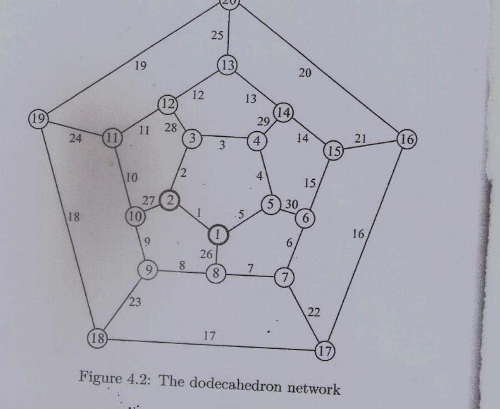

# תקציר

בעבודה נכתבה תוכנה (Python) שמעריכה את האמינות של רשת הדודקהדרון (20 קודקודים אמינים, 30 צלעות לא אמינות) בשיטת Crude Monte Carlo. קריטריון ה-UP הוא Terminal Connectivity, עם שלושה טרמינלים שנקבעו על ידי המרצה: **T1=4, T2=10, T3=17**. מצב הרשת בכל ניסוי נבדק באמצעות DSS (Union-Find).

עיקרי התוצאות:

- האמינות עולה בצורת S חדה עם p: מ-≈0 ב-p=0.1, דרך ≈0.19 ב-p=0.5, ועד ≈1 ב-p=0.99.
- כדי לאמת את התוכנה חושבה גם האמינות **המדויקת** R(p), באלגוריתם מדויק נפרד. כל אומדני ה-CMC עם M=10000 סטו מהערך המדויק בפחות מ-0.01 בערך מוחלט.
- סעיף E (p=0.9, M=1000, חמש הרצות): ממוצע 0.9962, סטיית תקן 0.00130, **טעות יחסית ≈ 0.13%**. הערך התיאורטי הוא 0.21%, ומדגם של חמש הרצות בלבד מסביר את הפער.

# שלב 1 – הגדרת הבעיה והרשת (סעיף B)

הרשת היא רשת הדודקהדרון (Figure 4.2): גרף לא מכוון, 3-רגולרי (לכל קודקוד 3 שכנים), עם n=20 קודקודים ו-m=30 צלעות.

{width=60%}

- **קודקודים אמינים, צלעות לא אמינות:** כל צלע i תקינה (up) בהסתברות p~i~, באופן בלתי תלוי בשאר הצלעות. בסעיף C כל הצלעות זהות: p~i~ = p.
- **קריטריון UP – Terminal Connectivity:** הרשת במצב UP אם ורק אם כל הטרמינלים נמצאים באותו רכיב קשירות של תת-הגרף המורכב מהצלעות התקינות.
- **טרמינלים:** T1=4, T2=10, T3=17 (כפי שנקבעו על ידי המרצה).
- **אמינות הרשת:** R = P(network is UP).

טבלת הצלעות כפי שנקראו מהשרטוט (מספור הצלע ושני קצותיה). הרישום אומת: לכל קודקוד דרגה 3 בדיוק.

| צלע | קצוות | צלע | קצוות | צלע | קצוות |
|:---:|:---:|:---:|:---:|:---:|:---:|
| 1 | 1-2 | 11 | 11-12 | 21 | 15-16 |
| 2 | 2-3 | 12 | 12-13 | 22 | 7-17 |
| 3 | 3-4 | 13 | 13-14 | 23 | 9-18 |
| 4 | 4-5 | 14 | 14-15 | 24 | 11-19 |
| 5 | 5-1 | 15 | 15-6 | 25 | 13-20 |
| 6 | 6-7 | 16 | 16-17 | 26 | 1-8 |
| 7 | 7-8 | 17 | 17-18 | 27 | 2-10 |
| 8 | 8-9 | 18 | 18-19 | 28 | 3-12 |
| 9 | 9-10 | 19 | 19-20 | 29 | 4-14 |
| 10 | 10-11 | 20 | 20-16 | 30 | 5-6 |

# שלב 2 – רקע תיאורטי: שיטת Crude Monte Carlo

נסמן ב-$X=(x_1,\dots,x_m)$ את וקטור מצב הצלעות ($x_i=1$ אם צלע i תקינה), וב-$\varphi(X)$ את פונקציית המבנה: $\varphi(X)=1$ אם הרשת UP, אחרת 0. אז:

$$R = P(\varphi(X)=1) = E[\varphi(X)] = \sum_{X}\varphi(X)\prod_{i=1}^{m}p_i^{x_i}(1-p_i)^{1-x_i}$$

חישוב מדויק דורש מעבר על $2^{30}\approx 10^9$ מצבים, ובאופן כללי הבעיה #P-קשה. לכן משתמשים בדגימה: מגרילים M וקטורי מצב בלתי תלויים $X^{(1)},\dots,X^{(M)}$ וסופרים בכמה מהם הרשת UP.

**האומד:**

$$\hat{r} = \frac{r}{M} = \frac{1}{M}\sum_{j=1}^{M}\varphi\left(X^{(j)}\right)$$

**חוסר הטיה:** כל $\varphi(X^{(j)})$ הוא משתנה ברנולי עם תוחלת R, ולכן $E[\hat{r}]=R$. המונה r מתפלג בינומית $Bin(M,R)$.

**שונות וטעות יחסית:**

$$Var(\hat{r}) = \frac{R(1-R)}{M}, \qquad RE(\hat{r}) = \frac{\sqrt{Var(\hat{r})}}{R} = \sqrt{\frac{1-R}{M\,R}}$$

משמעויות מעשיות:

- השגיאה יורדת כמו $1/\sqrt{M}$: מעבר מ-M=1000 ל-M=10000 מקטין את סטיית התקן פי $\sqrt{10}\approx 3.16$.
- רווח סמך מקורב ברמת 95%: $\hat{r} \pm 1.96\sqrt{\hat{r}(1-\hat{r})/M}$.
- **בעיית האירוע הנדיר:** כאשר $R\to 0$ (p נמוך), הטעות היחסית מתפוצצת; באופן סימטרי, כאשר $R\to 1$, הטעות היחסית באומדן אי-האמינות $Q=1-R$ מתפוצצת. זו המגבלה המרכזית של CMC, והיא נראית בתוצאות בקצוות.

# שלב 3 – התוכנה (סעיף A)

## 3.1 מיפוי שלבי הסכמה לקוד

1. **קליטת הרשת** – רשימת צלעות `EDGES` (זוגות קודקודים לפי מספור הצלע בשרטוט), מספר קודקודים ורשימת טרמינלים.
2. **אתחול** – r := 0.
3. **הגרלת מצב כל צלע** – מגרילים $x\sim U(0,1)$; אם $x\le p_i$ הצלע up, אחרת down. כך $P(up)=P(x\le p_i)=p_i$ בדיוק.
4. **בדיקת מצב הרשת** – בונים DSS של 20 קודקודים, מבצעים union על כל צלע תקינה, ובודקים ש-find(T1)=find(T2)=find(T3). אם כן – r := r+1.
5. **חזרה M פעמים** על שלבים 3-4.
6. **החזרת האומד** $\hat{r}=r/M$.

## 3.2 מבנה הנתונים DSS (Union-Find)

כל קודקוד מתחיל כקבוצה נפרדת. עבור כל צלע תקינה (u,v) מאחדים את קבוצותיהם. בסוף התהליך כל קבוצה היא רכיב קשירות של הגרף התקין, והטרמינלים מחוברים אם ורק אם הם באותו שורש. שתי אופטימיזציות סטנדרטיות מומשו:

- **Union by rank** – העץ הנמוך מוצמד לעץ הגבוה.
- **Path compression** – כל find מצמיד את הצמתים שעל המסלול ישירות לשורש.

סיבוכיות: כל פעולה עולה $O(\alpha(n))$ בממוצע ($\alpha$ היא הפונקציה ההפוכה לאקרמן, קבוע לכל צורך מעשי), ולכן ניסוי בודד עולה $O(m\cdot\alpha(n))$ וכל הסימולציה $O(M\cdot m\cdot\alpha(n))$.

## 3.3 קוד מרכזי (Python)

הקובץ המלא `cmc_reliability.py` מצורף לעבודה. להלן החלקים המרכזיים:

```python
EDGES = [(1,2),(2,3),(3,4),(4,5),(5,1),(6,7),(7,8),(8,9),(9,10),(10,11),
         (11,12),(12,13),(13,14),(14,15),(15,6),(16,17),(17,18),(18,19),
         (19,20),(20,16),(15,16),(7,17),(9,18),(11,19),(13,20),(1,8),
         (2,10),(3,12),(4,14),(5,6)]
N_NODES = 20
TERMINALS = (4, 10, 17)

class DSS:
    def __init__(self, n):
        self.parent = list(range(n + 1))
        self.rank = [0] * (n + 1)

    def find(self, x):
        root = x
        while self.parent[root] != root:
            root = self.parent[root]
        while self.parent[x] != root:          # path compression
            self.parent[x], x = root, self.parent[x]
        return root

    def union(self, a, b):
        ra, rb = self.find(a), self.find(b)
        if ra == rb:
            return
        if self.rank[ra] < self.rank[rb]:      # union by rank
            ra, rb = rb, ra
        self.parent[rb] = ra
        if self.rank[ra] == self.rank[rb]:
            self.rank[ra] += 1

def network_is_up(state):
    dss = DSS(N_NODES)
    for (u, v), up in zip(EDGES, state):
        if up:
            dss.union(u, v)
    root = dss.find(TERMINALS[0])
    return all(dss.find(t) == root for t in TERMINALS[1:])

def cmc_reliability(p, M, rng):
    r = 0                                          # step 2
    for _ in range(M):                             # step 5
        state = [rng.random() <= p for _ in EDGES] # step 3
        if network_is_up(state):                   # step 4
            r += 1
    return r / M                                   # step 6
```

הרצה: `python cmc_reliability.py`. מחולל המספרים האקראיים מאותחל עם seed=2026 כדי שהתוצאות יהיו ניתנות לשחזור.

# שלב 4 – תוצאות (סעיפים C, D)

**Terminals: T1=4, T2=10, T3=17**

עמודות M=1000 ו-M=10000 הן אומדני ה-CMC כנדרש בעבודה. העמודה האחרונה נוספה לצורך אימות: האמינות המדויקת (ראו שלב 6).

| p | M=1000 | M=10000 | R מדויק |
|:---:|:---:|:---:|:---:|
| 0.1 | 0.0000 | 0.0000 | 0.000003 |
| 0.2 | 0.0000 | 0.0001 | 0.000370 |
| 0.3 | 0.0030 | 0.0069 | 0.006670 |
| 0.4 | 0.0610 | 0.0478 | 0.048590 |
| 0.5 | 0.1950 | 0.2010 | 0.192759 |
| 0.6 | 0.4530 | 0.4711 | 0.471513 |
| 0.7 | 0.7920 | 0.7834 | 0.774040 |
| 0.8 | 0.9590 | 0.9493 | 0.948097 |
| 0.9 | 0.9940 | 0.9965 | 0.995711 |
| 0.95 | 1.0000 | 0.9997 | 0.999558 |
| 0.99 | 1.0000 | 1.0000 | 0.999997 |

ניתוח התוצאות:

- **צורת העקומה:** R(p) עולה באופן מונוטוני בצורת S, עם מעבר חד בתחום p≈0.4-0.8. מתחת ל-p≈0.3 הרשת כמעט תמיד DOWN: עץ שטיינר מינימלי שמחבר את 4, 10 ו-17 דורש 6 צלעות תקינות, וקיים רק עץ אחד כזה: 4-3-2-10-9-18-17 (צלעות 3, 2, 27, 9, 23, 17).
- **p=0.1, 0.2 עם M=1000:** האומד יצא 0 בדיוק. זו אינה שגיאה בתוכנה אלא בעיית האירוע הנדיר: עם $R=3\cdot10^{-6}$ מספר ההצלחות הצפוי הוא $M\cdot R\approx 0.003$ ב-1000 ניסויים. כדי לאמוד את R ב-p=0.1 עם טעות יחסית של 10% נדרש $M\approx(1-R)/(R\cdot0.01)\approx 3\cdot10^{7}$.
- **p=0.95, 0.99:** באופן סימטרי, אי-האמינות Q קטנה מדי כדי להיצפות ב-1000 דגימות (תוחלת מספר הכשלונות היא 0.44 ו-0.003), ולכן האומד יצא 1.0000. כש-R קרובה ל-1 מקובל לאמוד את Q בשיטות מתקדמות יותר (Permutation Monte Carlo, Turnip).
- **M=1000 מול M=10000:** הסטייה המקסימלית מהערך המדויק ירדה מ-0.0185 (M=1000, p=0.6) ל-0.0094 (M=10000, p=0.7). זה תואם את הצפוי מסטיית התקן התיאורטית: ב-p=0.6 היא 0.0158 עם M=1000 ו-0.0050 עם M=10000.

# שלב 5 – טעות יחסית (סעיף E)

הרצנו את ה-CMC חמש פעמים באופן בלתי תלוי עם p=0.9 ו-M=1000:

| הרצה | 1 | 2 | 3 | 4 | 5 |
|:---:|:---:|:---:|:---:|:---:|:---:|
| $\hat{r}$ | 0.996 | 0.998 | 0.995 | 0.997 | 0.995 |

**שלב א – ממוצע:**

$$\bar{r} = \frac{1}{5}\sum_{k=1}^{5}\hat{r}_k = \frac{0.996+0.998+0.995+0.997+0.995}{5} = 0.9962$$

**שלב ב – סטיית תקן מדגמית** (הסטיות מהממוצע: −0.0002, +0.0018, −0.0012, +0.0008, −0.0012):

$$s = \sqrt{\frac{1}{5-1}\sum_{k=1}^{5}\left(\hat{r}_k-\bar{r}\right)^2} = \sqrt{\frac{6.8\cdot10^{-6}}{4}} = 0.00130$$

**שלב ג – טעות יחסית:**

$$RE = \frac{s}{\bar{r}} = \frac{0.00130}{0.9962} = 0.00131 \approx 0.13\%$$

**שלב ד – השוואה לתיאוריה:** לפי הנוסחה משלב 2, עם הערך המדויק R(0.9)=0.995711:

$$RE_{theory} = \sqrt{\frac{1-R}{M\,R}} = \sqrt{\frac{0.004289}{1000\cdot0.995711}} = 0.00208 \approx 0.21\%$$

מסקנות לסעיף E:

- הטעות היחסית שנמדדה (0.13%) נמוכה מהערך התיאורטי (0.21%), אבל באותו סדר גודל. סטיית תקן שמחושבת מ-5 דגימות בלבד היא אומד רועש מאוד (4 דרגות חופש), ופער כזה צפוי.
- הסטייה היחסית של הממוצע מהערך המדויק היא |0.9962−0.995711|/0.995711 = 0.05%.
- טעות יחסית נמוכה באומדן R אינה מעידה על דיוק טוב באומדן אי-האמינות: עבור Q=1−R=0.00429 הטעות היחסית היא $\sqrt{R/(M\cdot Q)}\approx 48\%$. כלומר, עם M=1000 ה-CMC אומד היטב את R, אבל כמעט לא את הסיכוי לכשל.

# שלב 6 – אימות מול חישוב מדויק ומסקנות

## 6.1 חישוב R(p) מדויק (תוספת לאימות)

כדי לבדוק שהתוכנה נכונה ולא רק "נראית סבירה", מומש אלגוריתם מדויק מסוג frontier-based dynamic programming: עוברים על הצלעות לפי הסדר, ושומרים רק את חלוקת קודקודי ה"חזית" לרכיבים ואת הטרמינלים שבכל רכיב. התוצאה היא וקטור $N_k$ – מספר תתי-הקבוצות של k צלעות תקינות שמחברות את הטרמינלים – וממנו פולינום האמינות:

$$R(p) = \sum_{k=0}^{30} N_k\, p^k (1-p)^{30-k}$$

האלגוריתם המדויק נבדק בעצמו מול מעבר מלא על כל המצבים (brute force) ב-30 גרפים אקראיים קטנים, ונמצאה התאמה מלאה. עבור הדודקהדרון עם הטרמינלים 4, 10, 17 התקבל: $N_0=\dots=N_5=0$, $N_6=1$ (עץ השטיינר המינימלי היחיד), $N_7=39$, $N_{30}=1$. סך הכל 206,973,936 מתוך $2^{30}\approx1.07\cdot10^9$ מצבים הם מצבי UP, ולכן $R(0.5)=206{,}973{,}936/2^{30}=0.1928$.

## 6.2 השוואת CMC לערך המדויק

בדקנו את כל אומד מול רווח סמך של 95% סביב הערך המדויק ($\pm1.96\sqrt{R(1-R)/M}$). עבור M=1000 כל 11 האומדים נמצאים בתוך הרווח (הסטייה הגדולה ביותר היא 1.83 סטיות תקן, ב-p=0.4). עבור M=10000, 9 מתוך 11 בתוך הרווח, ושניים מעט מחוצה לו: p=0.5 (2.09 סטיות תקן) ו-p=0.7 (2.24 סטיות תקן). ב-22 הערכות ברמת ביטחון 95% מצפים שכ-1.1 ייפלו מחוץ לרווח במקרה, ולכן שתי חריגות קלות עקביות עם התאוריה. הסטיות אינן שיטתיות: חלקן מעל הערך המדויק וחלקן מתחתיו, בהתאם לאומד חסר הטיה.

## 6.3 מסקנות

1. תוכנת ה-CMC עם DSS פשוטה למימוש, כללית (כל רשת, כל $p_i$, כל קבוצת טרמינלים) ומספקת אומד חסר הטיה שתואם את הערך המדויק.
2. הדיוק משתפר כמו $1/\sqrt{M}$ – רווח של ספרה עשרונית נוספת מחייב פי 100 דגימות.
3. השיטה טובה כאשר R אינה קיצונית, ונכשלת באירועים נדירים: ב-p=0.1, 0.2 וב-p=0.95, 0.99 קיבלנו אומדים של 0 או 1 בדיוק, ללא מידע על סדר הגודל של R או של Q. זהו המניע לשימוש בשיטות הפחתת שונות כמו Permutation Monte Carlo ו-Turnip.
