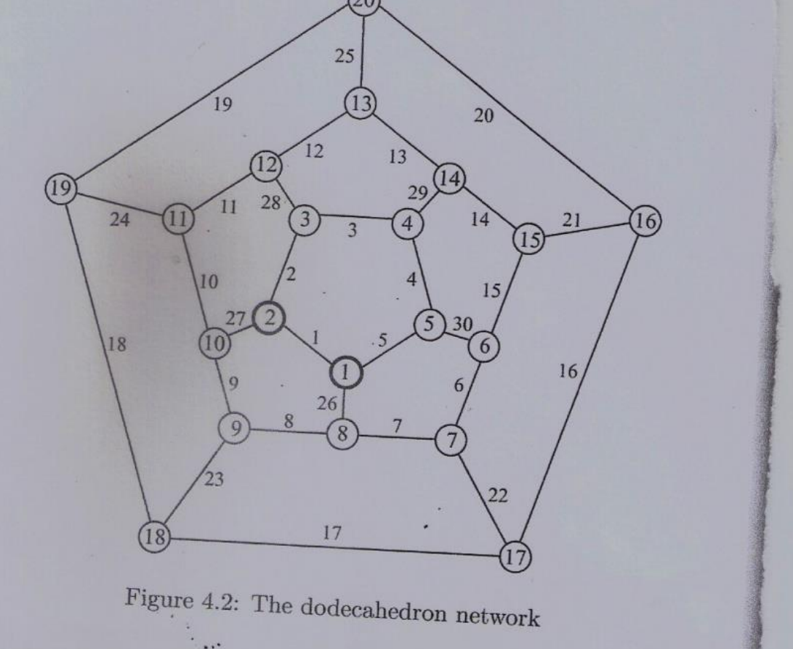

# תקציר

בעבודה נכתבה תוכנה (Python) שמעריכה את האמינות של רשת הדודקהדרון בעזרת ה-**Destruction Spectrum** (D-spectrum), ומשווה אותה לשיטת Crude Monte Carlo (CMC). הרשת לא מכוונת, הצלעות לא אמינות והקודקודים אמינים. קריטריון ה-UP הוא Terminal Connectivity, עם הטרמינלים **T1=4, T2=10, T3=17**.

עיקרי התוצאות:

- חושבו שלושה D-spectra, עם M=1000, M=10000 ו-M=50000 (טבלה 1). הספקטרום שונה מאפס רק בתחום i=3..24, ושיאו ב-i=12. כלומר, בדרך כלל הרשת "נופלת" אחרי כ-12 כשלים.
- מכל ספקטרום חושבה האמינות לכל 11 ערכי p (טבלה 2), וחושבה גם האמינות ב-CMC (טבלה 3). שתי השיטות נותנות את אותה עקומת S.
- **המסקנה המרכזית (טבלה 4):** עבור p=0.95 ו-M=1000, הטעות היחסית של ה-D-spectrum היא 1.74e-04, לעומת 8.50e-04 ב-CMC. כלומר, ה-D-spectrum מדויק פי 4.9. ב-7 מתוך 10 ההרצות CMC לא ראה אף כשל, והחזיר אמינות 1 בדיוק.

# שלב 1 – הגדרת הבעיה והרשת

הרשת היא רשת הדודקהדרון (Figure 4.2), אותה רשת כמו בחלק א': גרף לא מכוון, 3-רגולרי, עם n=30 צלעות ו-20 קודקודים. גם הטרמינלים זהים לחלק א'.

{width=60%}

- **הצלעות לא אמינות, הקודקודים אמינים:** כל צלע תקינה בהסתברות p ותקולה בהסתברות q=1−p, באופן בלתי תלוי. לכל הצלעות אותו p.
- **קריטריון UP – Terminal Connectivity:** הרשת במצב UP אם ורק אם שלושת הטרמינלים 4, 10, 17 נמצאים באותו רכיב קשירות של הצלעות התקינות.
- **שתי עובדות מבניות שיעזרו בהמשך:**
    - לכל טרמינל יש 3 צלעות בלבד, ולכן 3 כשלים מספיקים כדי לנתק את הרשת. אין דרך לנתק אותה בפחות מ-3 כשלים.
    - כדי לחבר את 4, 10 ו-17 צריך לפחות 6 צלעות תקינות, למשל המסלול `4-3-2-10-9-18-17`.

# שלב 2 – רקע תיאורטי: Destruction Spectrum

## 2.1 ההגדרה

מסדרים את 30 הצלעות בסדר אקראי (תמורה אקראית אחידה), ו"הורסים" אותן אחת אחרי השנייה לפי הסדר הזה. בהתחלה כל הצלעות תקינות והרשת UP. בשלב כלשהו, כישלון של צלע מסוימת הופך את הרשת ל-DOWN. המיקום של הצלע הזו בתמורה נקרא **העוגן** (anchor), ומסומן r.

**ה-D-spectrum** הוא התפלגות העוגן:

$$f_i = P(r = i), \qquad i = 1,\dots,n, \qquad \sum_{i=1}^{n} f_i = 1$$

ה-D-spectrum **המצטבר** הוא $F(x) = f_1 + \dots + f_x$, כלומר ההסתברות שהרשת כבר DOWN אחרי x כשלים.

## 2.2 מהספקטרום לאמינות

**טענה:** $F(x)$ שווה לחלק היחסי של קבוצות x הצלעות שכישלונן מפיל את הרשת, מתוך כל $\binom{n}{x}$ הקבוצות האפשריות.

**הסבר:** בתמורה אקראית אחידה, קבוצת x הצלעות הראשונות היא קבוצה אקראית אחידה מבין כל $\binom{n}{x}$ הקבוצות. הרשת מונוטונית: אם היא DOWN, הריסה של צלעות נוספות לא תחזיר אותה ל-UP. לכן "העוגן ≤ x" שקול ל"קבוצת x הצלעות הראשונות מפילה את הרשת".

מכאן, כשמספר הצלעות התקולות הוא x, כל קבוצה של x צלעות תקולות סבירה באותה מידה (כי לכל הצלעות אותו p), וההסתברות ל-DOWN היא בדיוק F(x). מספר הצלעות התקולות מתפלג בינומית, ולכן:

$$Q(N;p) = \sum_{x=1}^{n} F(x)\binom{n}{x} q^{x} p^{\,n-x}, \qquad R(N;p) = 1 - Q(N;p)$$

**הנקודה החשובה:** הספקטרום תלוי רק במבנה הרשת ובטרמינלים, ולא ב-p. לכן מחשבים אותו פעם אחת, ומקבלים ממנו את האמינות לכל ערך של p. זו הסיבה שמכל ספקטרום בטבלה 1 יוצאת עמודה שלמה בטבלה 2.

## 2.3 אמידת הספקטרום ב-Monte Carlo

מגרילים M תמורות אקראיות, ולכל אחת מוצאים את העוגן. אם $a_i$ הוא מספר התמורות שהעוגן שלהן הוא i, האומד הוא $\hat f_i = a_i / M$. זהו אומד חסר הטיה של $f_i$. מכיוון ש-R היא פונקציה ליניארית של $f_1,\dots,f_n$, גם $\hat R$ הוא אומד חסר הטיה של R.

## 2.4 למה ה-D-spectrum מדויק יותר מ-CMC

אפשר לכתוב את Q גם כך:

$$Q = \sum_{r=1}^{n} f_r\, G(r), \qquad G(r) = P(\text{Bin}(n,q) \ge r)$$

כלומר, כל תמורה תורמת לאומדן את ההסתברות **המדויקת** $G(r)$ שיהיו לפחות r כשלים. ב-CMC, לעומת זאת, כל ניסוי תורם רק 0 או 1.

כש-p גבוה, כשל של הרשת הוא אירוע נדיר: ב-CMC רוב הניסויים מחזירים 1 ולא מוסיפים מידע על Q. ב-D-spectrum כל תמורה מוסיפה מידע, גם כשהאירוע נדיר. זו שיטה מסוג Conditional Monte Carlo.

**למה השונות לעולם לא גדולה יותר:** אפשר לדמות ניסוי CMC כך: מגרילים תמורה π ובנפרד מספר כשלים $X\sim\text{Bin}(n,q)$, ומפילים את X הצלעות הראשונות בתמורה. הרשת DOWN אם ורק אם $X \ge r(\pi)$, ולכן $G(r) = E[\,1\{DOWN\}\mid \pi\,]$. לפי משפט Rao–Blackwell, תוחלת מותנית לא מגדילה שונות: $Var(G(r)) \le Var(1\{DOWN\})$. מכאן שלכל p, השונות של אומד ה-D-spectrum קטנה או שווה לזו של CMC עם אותו M, והיתרון הגדול ביותר כשהאירוע נדיר.

## 2.5 תזכורת: CMC

לכל צלע מגרילים x בין 0 ל-1, והצלע up אם x ≤ p. בודקים אם הרשת UP, וחוזרים M פעמים. האומד הוא $\hat r = r/M$, השונות שלו $R(1-R)/M$, והטעות היחסית $\sqrt{(1-R)/(MR)}$.

# שלב 3 – התוכנה

הקובץ `dspectrum_reliability.py` (Python 3, ספרייה סטנדרטית בלבד):

| חלק | מה הקוד עושה | שורות |
|:---|:---|:---:|
| הרשת | רשימת 30 הצלעות לפי המספור בשרטוט, הטרמינלים, ערכי p וערכי M | 19–56 |
| DSS | Union-Find עם path compression ו-union by rank, כמו בחלק א' | 62–89 |
| העוגן | הפונקציה `anchor` מוצאת את העוגן של תמורה אחת | 104–112 |
| ה-D-spectrum | הפונקציה `d_spectrum` מגרילה M תמורות (`rng.shuffle`) וסופרת עוגנים | 115–123 |
| האמינות מהספקטרום | הפונקציה `reliability_from_spectrum` מחשבת את הנוסחה משלב 2.2 | 126–136 |
| CMC | `network_is_up` ו-`cmc_reliability`, כמו בחלק א' | 142–156 |
| טעות יחסית | `relative_error` מחזירה ממוצע, s (n−1) ו-r.e. = s/ממוצע | 159–164 |
| הניסויים | `main` מריצה את סעיפים (1)–(6) ומדפיסה את ארבע הטבלאות | 170–211 |

## 3.1 איך מוצאים את העוגן בעזרת DSS

הריסת הצלעות $e_1, e_2, \dots$ לפי הסדר שקולה לבניית הרשת **מהסוף להתחלה**: מתחילים מרשת ריקה ומוסיפים את $e_n, e_{n-1}, \dots$. אם הטרמינלים מתחברים בדיוק כשמוסיפים את $e_r$, אז כשכל הצלעות מ-$e_r$ ואילך תקינות הרשת UP, ובלי $e_r$ היא DOWN. לכן הכשל של $e_r$ הוא זה שמפיל את הרשת, ו-r הוא העוגן.

היתרון: DSS יודע רק לאחד קבוצות ולא לפצל אותן, ולכן בנייה מתאימה לו בדיוק. כל תמורה דורשת לכל היותר 30 פעולות union.

```python
def anchor(perm, edges=EDGES, n_nodes=N_NODES, terminals=TERMINALS):
    dss = DSS(n_nodes)
    for r in range(len(perm), 0, -1):            # add e_n, e_(n-1), ..., e_1
        u, v = edges[perm[r - 1]]
        dss.union(u, v)
        if terminals_connected(dss, terminals):
            return r

def d_spectrum(M, rng, ...):
    counts = [0] * n
    perm = list(range(n))
    for _ in range(M):
        rng.shuffle(perm)                          # uniform random permutation
        counts[anchor(perm, ...) - 1] += 1
    return [c / M for c in counts]

def reliability_from_spectrum(f, p):
    n, q = len(f), 1 - p
    F, unrel = 0.0, 0.0
    for x in range(1, n + 1):
        F += f[x - 1]
        unrel += F * math.comb(n, x) * q ** x * p ** (n - x)
    return 1 - unrel
```

הרצה: `python dspectrum_reliability.py`. כל ההרצה לוקחת כ-8 שניות. המחולל האקראי מאותחל עם seed=2026, כך שהתוצאות ניתנות לשחזור.

# שלב 4 – Table 1: Destruction Spectra (סעיף 1)

### Table 1 – Destruction Spectra (Terminals: T1=4, T2=10, T3=17)

| i | M=1000 (f_i) | M=10000 (f_i) | M=50000 (f_i) |
|:---:|:---:|:---:|:---:|
| 1 | 0.00000 | 0.00000 | 0.00000 |
| 2 | 0.00000 | 0.00000 | 0.00000 |
| 3 | 0.00100 | 0.00160 | 0.00078 |
| 4 | 0.00300 | 0.00300 | 0.00244 |
| 5 | 0.00400 | 0.00590 | 0.00638 |
| 6 | 0.00800 | 0.01120 | 0.01198 |
| 7 | 0.02100 | 0.02240 | 0.02230 |
| 8 | 0.03400 | 0.03220 | 0.03854 |
| 9 | 0.07200 | 0.06360 | 0.06326 |
| 10 | 0.08400 | 0.10220 | 0.10012 |
| 11 | 0.13100 | 0.14500 | 0.13802 |
| 12 | 0.18000 | 0.16340 | 0.16218 |
| 13 | 0.14400 | 0.14710 | 0.15266 |
| 14 | 0.12400 | 0.11740 | 0.11750 |
| 15 | 0.07100 | 0.08040 | 0.08098 |
| 16 | 0.05400 | 0.04950 | 0.04910 |
| 17 | 0.03500 | 0.02950 | 0.02792 |
| 18 | 0.02200 | 0.01470 | 0.01390 |
| 19 | 0.00900 | 0.00600 | 0.00686 |
| 20 | 0.00200 | 0.00310 | 0.00324 |
| 21 | 0.00000 | 0.00130 | 0.00134 |
| 22 | 0.00100 | 0.00030 | 0.00034 |
| 23 | 0.00000 | 0.00010 | 0.00016 |
| 24 | 0.00000 | 0.00010 | 0.00000 |
| 25 | 0.00000 | 0.00000 | 0.00000 |
| 26 | 0.00000 | 0.00000 | 0.00000 |
| 27 | 0.00000 | 0.00000 | 0.00000 |
| 28 | 0.00000 | 0.00000 | 0.00000 |
| 29 | 0.00000 | 0.00000 | 0.00000 |
| 30 | 0.00000 | 0.00000 | 0.00000 |

ניתוח:

- **$f_1 = f_2 = 0$ בכל העמודות:** לכל טרמינל יש 3 צלעות, ולכן אי אפשר לנתק אותו בפחות מ-3 כשלים.
- **$f_i = 0$ עבור i ≥ 25:** אחרי 25 כשלים נשארות רק 5 צלעות תקינות, ו-5 צלעות לא מספיקות כדי לחבר את שלושת הטרמינלים (צריך לפחות 6). לכן הרשת בוודאות DOWN לכל המאוחר בכשל ה-25. כדי שהעוגן יהיה בדיוק 25, 6 הצלעות האחרונות בתמורה צריכות להיות בדיוק עץ מחבר מינימלי. זה אירוע נדיר מאוד, ולא נצפה.
- **השיא ב-i=12** (כ-0.16): ברוב התמורות הרשת נופלת אחרי 10–14 כשלים.
- **התכנסות:** ככל ש-M גדל, הערכים מתייצבים. עם M=1000 תאים שהסתברותם קטנה יוצאים לפעמים 0 (למשל i=21), כי לא נצפה בהם אף עוגן. עם M=50000 הספקטרום חלק ומלא.

# שלב 5 – Tables 2, 3: אמינות לפי D-spectrum ולפי CMC (סעיפים 2, 3)

### Table 2 – R(N;p) (Destruction Spectrum)

| p | M=1000 (R) | M=10000 (R) | M=50000 (R) |
|:---:|:---:|:---:|:---:|
| 0.1 | 0.000002 | 0.000005 | 0.000003 |
| 0.2 | 0.000383 | 0.000407 | 0.000398 |
| 0.3 | 0.007557 | 0.006801 | 0.006843 |
| 0.4 | 0.054053 | 0.048896 | 0.048802 |
| 0.5 | 0.204331 | 0.193006 | 0.192734 |
| 0.6 | 0.485222 | 0.471839 | 0.471309 |
| 0.7 | 0.784444 | 0.775214 | 0.773577 |
| 0.8 | 0.952428 | 0.948251 | 0.947588 |
| 0.9 | 0.996061 | 0.995125 | 0.995620 |
| 0.95 | 0.999525 | 0.999372 | 0.999549 |
| 0.99 | 0.999996 | 0.999994 | 0.999997 |

### Table 3 – R(N;p) (CMC)

| p | M=1000 (R) | M=10000 (R) | M=50000 (R) |
|:---:|:---:|:---:|:---:|
| 0.1 | 0.000000 | 0.000000 | 0.000020 |
| 0.2 | 0.001000 | 0.000000 | 0.000340 |
| 0.3 | 0.004000 | 0.005900 | 0.006640 |
| 0.4 | 0.042000 | 0.046100 | 0.048720 |
| 0.5 | 0.201000 | 0.200800 | 0.191360 |
| 0.6 | 0.458000 | 0.465500 | 0.472400 |
| 0.7 | 0.788000 | 0.777000 | 0.772680 |
| 0.8 | 0.941000 | 0.944600 | 0.948280 |
| 0.9 | 0.997000 | 0.995900 | 0.996040 |
| 0.95 | 1.000000 | 0.999600 | 0.999520 |
| 0.99 | 1.000000 | 1.000000 | 1.000000 |

ניתוח:

- **שתי השיטות נותנות את אותה עקומת S:** כמעט 0 עד p≈0.3, מעבר חד בין p=0.4 ל-p=0.8, ומעל 0.99 מ-p=0.9. עם M=50000 ההפרש בין השיטות קטן מ-1.5 שגיאות תקן של CMC בכל ערכי p חוץ מ-p=0.1. שם ההפרש הוא 2.2 שגיאות תקן, כי CMC ראה הצלחה אחת בלבד ב-50,000 ניסויים. כלומר, השיטות מתיישבות זו עם זו.
- **בקצוות ה-D-spectrum נותן מידע ש-CMC לא נותן:**
    - ב-p=0.1, CMC מחזיר 0 (פרט להצלחה בודדת עם M=50000), וה-D-spectrum נותן ערכים חיוביים מסדר גודל של $10^{-6}$, עקביים בין שלוש העמודות.
    - ב-p=0.99, CMC מחזיר 1.000000 בכל העמודות, וה-D-spectrum נותן 0.999994–0.999997, כלומר אי-אמינות של כ-$3\cdot10^{-6}$ עד $6\cdot10^{-6}$.
- **מבנה השגיאה שונה:** כל עמודה בטבלה 2 מחושבת מספקטרום **אחד**. לכן אם הספקטרום של M=1000 מוטה מעט לכיוון עוגנים מאוחרים, כל העמודה זזה יחד, וזו הסיבה שעמודת M=1000 גבוהה מעט מהאחרות בתחום p=0.4–0.8. בטבלה 3 כל תא הוא הרצה נפרדת, והשגיאות בין התאים בלתי תלויות.
- **השפעת M, ויציבות כל שיטה:** בשתי השיטות עמודת M=1000 רועשת יותר, כצפוי משגיאה שיורדת כמו $1/\sqrt{M}$. אבל ב-D-spectrum העמודות של M=10000 ו-M=50000 כמעט זהות (הפרש של לכל היותר 0.0016), וב-CMC הפערים ביניהן גדולים עד פי 6 (למשל 0.0094 ב-p=0.5). כלומר, גם באמצע התחום ה-D-spectrum יציב יותר מ-CMC באותו M.

# שלב 6 – Table 4: טעות יחסית עבור p=0.95 (סעיפים 4, 5)

עם M=1000 חושבו 10 ספקטרומים שונים, ומכל אחד האמינות ב-p=0.95 (סעיף 4). באותם תנאים הורץ CMC עשר פעמים (סעיף 5):

### Table 4 – R(N; p = 0.95), M=1000

| i | Destruction Spectrum | CMC |
|:---:|:---:|:---:|
| 1 | 0.999578 | 1.0000 |
| 2 | 0.999571 | 1.0000 |
| 3 | 0.999609 | 1.0000 |
| 4 | 0.999673 | 1.0000 |
| 5 | 0.999674 | 0.9980 |
| 6 | 0.999233 | 0.9980 |
| 7 | 0.999311 | 1.0000 |
| 8 | 0.999814 | 1.0000 |
| 9 | 0.999626 | 0.9990 |
| 10 | 0.999637 | 1.0000 |
| ממוצע | 0.999573 | 0.9995 |
| s | 1.73e-04 | 8.50e-04 |
| **r.e.** | **1.74e-04** | **8.50e-04** |

**חישוב הטעות היחסית** (לכל עמודה בנפרד):

$$\bar R = \frac{1}{10}\sum_{i=1}^{10} R_i, \qquad s = \sqrt{\frac{1}{10-1}\sum_{i=1}^{10}\left(R_i-\bar R\right)^2}, \qquad r.e. = \frac{s}{\bar R}$$

- **D-spectrum:** $\bar R$ = 0.999573, s = 1.73e-04, **r.e. = 1.74e-04** (כ-0.017%).
- **CMC:** $\bar R$ = 0.9995, s = 8.50e-04, **r.e. = 8.50e-04** (כ-0.085%).

ניתוח:

- **ה-D-spectrum מדויק פי 4.9** באותו מספר חזרות M=1000.
- **CMC כמעט "עיוור" כאן:** אי-האמינות ב-p=0.95 היא כ-0.00045 (לפי הספקטרום של M=50000). לכן בהרצה של 1000 ניסויים מצפים לכ-0.45 כשלים בלבד, וההסתברות שהרצה לא תראה אף כשל ותחזיר 1 בדיוק היא כ-$(1-0.00045)^{1000}\approx 0.64$. בפועל 7 מתוך 10 ההרצות החזירו 1.0000. ערך ה-r.e. של CMC נשען על הרצות בודדות שבהן נצפו כשלים, ולכן הוא עצמו לא יציב.
- **התאמה לתיאוריה:** הטעות היחסית התיאורטית של CMC היא $\sqrt{(1-R)/(MR)}\approx 6.7\cdot10^{-4}$, באותו סדר גודל של הערך שנמדד (8.50e-04).
- **ה-D-spectrum לא "עיוור":** כל אחד מ-10 הספקטרומים נותן אמידה חיובית של Q, כי כל תמורה תורמת את ההסתברות G(r) (שלב 2.4) ולא 0 או 1.

# שלב 7 – מסקנות

1. **ה-D-spectrum מפריד בין המבנה להסתברות:** את הספקטרום מחשבים פעם אחת, והוא נותן את האמינות לכל ערך של p בנוסחה סגורה. ב-CMC צריך סימולציה נפרדת לכל p.
2. **באמצע התחום שתי השיטות שקולות,** ונותנות את אותה עקומת S בתוך טווח השגיאה הסטטיסטית.
3. **בקצוות, ובמיוחד כש-p גבוה, ה-D-spectrum עדיף בבירור.** עם M=1000 ו-p=0.95 הטעות היחסית שלו קטנה פי 4.9 מזו של CMC. CMC מחזיר לרוב 1 בדיוק ולא אומר דבר על אי-האמינות, וה-D-spectrum נותן לה אמידה חיובית ויציבה.
4. **מגבלה:** הנוסחה משלב 2.2 מניחה שלכל הצלעות אותו p. ל-$p_i$ שונים אין לספקטרום משמעות ישירה, ושם CMC נשאר כללי יותר.
